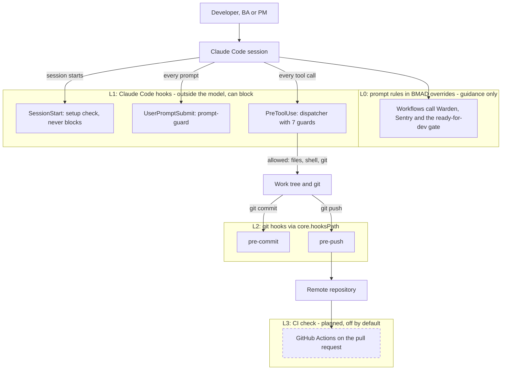
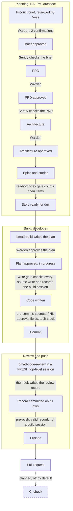
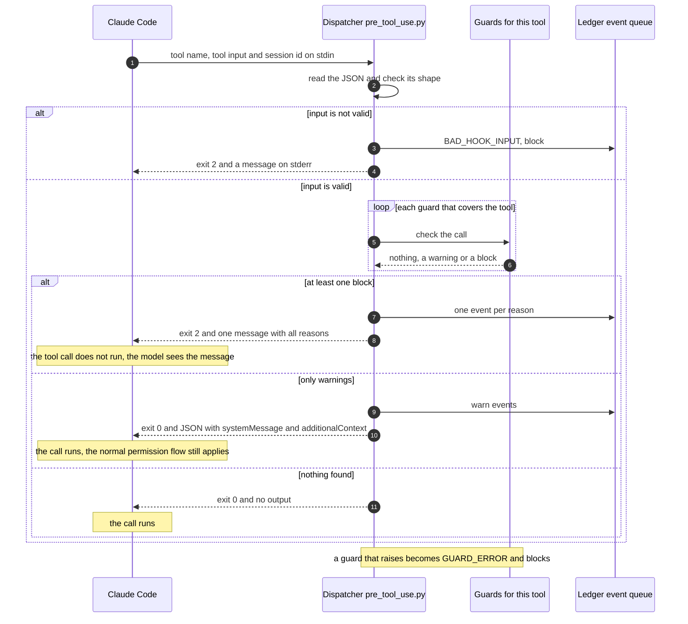
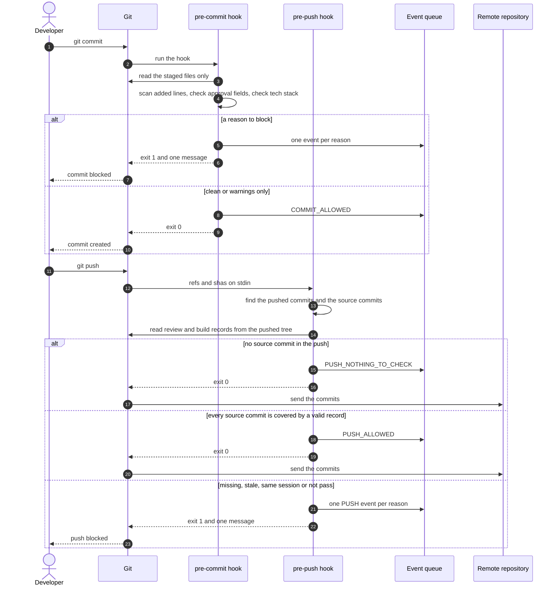
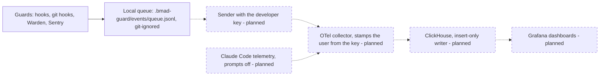

# Architecture

| | |
|---|---|
| Ticket | GUARD-3, T0 (pilot pack) |
| Status | Describes what Phase 2 built, plus what Phase 3 plans (marked **planned**). Checked against the code on 2026-11-26. |
| Decisions | [ADR 0001](adr/0001-architecture.md) (stock BMAD plus a module), [0002](adr/0002-enforcement-layers.md) (layers), [0003](adr/0003-event-logging.md) (events), [0004](adr/0004-ready-for-dev-gate.md) (ready-for-dev gate), [0006](adr/0006-local-prompt-check.md) (local prompt check) |
| Guides | [Install](guides/install.md), [developer](guides/developer.md), [BA / PM](guides/ba-pm.md), [reviewer](guides/reviewer.md), [trial run](guides/trial-run.md) |

## 1. The idea

Prompt rules alone do not stop a model. It can write "approved" into a document, write code before the plan is approved, or skip a check. So the guards run **outside the model** and can block.

- BMAD stays stock (v6.12.4). No fork, no edits to BMAD files.
- All our changes are a **module**: guard skills, overrides in `_bmad/custom/`, git hooks, and wiring in `.claude/settings.json`.
- Guards are small Python scripts (standard library only) with a clear answer: allow, warn or block.
- Every guard decision is an **event**. Events never carry content.

## 2. Layers

| Layer | What | Can the model skip it? | Status |
|---|---|---|---|
| L0 | Prompt rules in `_bmad/custom` overrides. They add guard steps (Warden, Sentry, the ready-for-dev gate) to BMAD workflows. | Yes. It is guidance only. | Built |
| L1 | Claude Code hooks: `SessionStart`, `UserPromptSubmit`, `PreToolUse`. They run before the prompt or tool call and can block it. | No (the model does not run them). A person can switch them off in a local settings file, until managed settings are rolled out. | Built |
| L2 | Git hooks `pre-commit` and `pre-push`, plain Python, set with `core.hooksPath`. | Not the agent (`--no-verify` is blocked). A person can skip them. | Built |
| L3 | CI check on the pull request. Same rules, on the server, so a skipped local hook is caught. | No | **Planned** (Phase 3, T6). Off by default. |



Managed settings (a file IT installs, one template per OS in `module/managed-settings/`) can lock the L1 hooks so a developer cannot turn them off. With the machine templates (ADR 0008) the hook scripts run from a root-owned machine folder (`scripts/install_machine.py`), so they cannot be edited per project, and a project without the module is not blocked: each hook first asks whether the project uses the guard (no `_bmad/`: allow silently; `_bmad/` without `_bmad/custom/guard/manifest.json`: allow and one line at session start; manifest present: all guards, fail closed). Built and tested in temp folders (Phase 3, T5); the real-machine steps are in [managed-settings-rollout.md](managed-settings-rollout.md).

## 3. The process, end to end

Two kinds of checks work together:

- **Skills called by BMAD workflows** (L0): Warden asks a person to approve a document. Sentry checks that an approval is still valid. The ready-for-dev gate counts open questions. They depend on the model following the workflow, so L1 and L2 back them up.
- **Hooks** (L1, L2): they run whatever the model does.



Notes on the diagram:

- **Stories.** In the current overrides `epics.md` gets a confidence score but no Warden step. What stops a story is the **ready-for-dev gate** (counted facts) and the **plan approval** by Warden in `bmad-build`.
- **Approval is by hash.** Warden stores a hash of the text. A later edit makes Sentry say `stale`, and sets the document back to `draft`.
- **The write gate** blocks any source write until the current plan is approved and unchanged and the story is ready. It also writes the **build record** (which session built the story).
- **The review record** is written by the hook, not by the model. The push check refuses a reviewer who is a build session.

## 4. One tool call through the dispatcher (L1, `PreToolUse`)

Claude Code runs one hook entry, `pre_tool_use.py`, for the tools `Bash`, `Read`, `Grep`, `Glob`, `Write`, `Edit`, `MultiEdit` and `NotebookEdit`. The dispatcher runs every guard that covers the tool, in one process, and prints one message for all reasons.



Only the **content scan** can warn instead of block, and only in a project that is not HIPAA. Everything else blocks.

## 5. One commit and one push through L2



`pre-commit` reads the **staged** version, never the work tree. `pre-push` reads the records from the **pushed** tree. Both hooks only write to the local queue and never wait on the network.

## 6. The guards

| Guard | Runs on | Tools or step | Rule families | What it checks | If it fails |
|---|---|---|---|---|---|
| Setup check | L1 `SessionStart` | session start | `SETUP_INCOMPLETE` | `core.hooksPath` and the hook wiring (project or managed file). | Never blocks. It warns. |
| prompt-guard (Marshal) | L1 `UserPromptSubmit` | every prompt | `PROMPT_SECRET`, `PROMPT_PHI`, `PROMPT_INJECTION`, `PROMPT_SIZE` | Secrets, identifiers, injection phrasing, size. Actions: block, warn, record, off. | HIPAA project: block. Other: warn. |
| command-guard | L1 `PreToolUse` | Bash | `CMD_*`, `EXPORT_*` | Destructive commands, `--no-verify`, `core.hooksPath`, data export, commands it cannot read. | Block |
| path-guard | L1 `PreToolUse` | Read, Edit, MultiEdit, Write, NotebookEdit, Grep, Glob, paths in Bash | `PATH_*` | Env files, keys, dumps, `~/.aws`, `~/.ssh`, `~/.config/bmad-guard`. | Block |
| document-guard | L1 `PreToolUse` | Write, Edit, MultiEdit, NotebookEdit | `DOC_*` | Approval fields, `approval-state.json`, guard records, guard config, the guard's own files, removed questions. | Block |
| bash-write-guard | L1 `PreToolUse` | Bash | `DOC_*` (same ids) | The same protected files, written from the shell (redirects, `tee`, `cp`, `mv`, `sed -i`, `rm` ...). Best effort. | Block |
| write-gate | L1 `PreToolUse` | Write, Edit, MultiEdit, NotebookEdit, Bash write targets | `GATE_*` | Source write needs an approved, unchanged plan and a ready story. Records the build session. | Block |
| content-scan | L1 `PreToolUse` | Write, Edit, MultiEdit, NotebookEdit, text a Bash command writes to a file | `CONTENT_SECRET`, `CONTENT_PHI` | Secrets and identifiers in the new text. | HIPAA project: block. Other: warn. |
| review-record | L1 `PreToolUse` | Bash | `REVIEW_*` | Recognises the one plain record command and writes the review record with the hook's session id. | Block |
| pre-commit | L2 | `git commit` | `COMMIT_*` | Secrets and identifiers in added lines, approval fields vs Warden's record, tech-stack list. | Block (`COMMIT_ERROR`) |
| pre-push | L2 | `git push` | `PUSH_*` | An independent review record for source commits. | Block (`PUSH_ERROR`) |

Rules, ids and limits: [guard-rules.md](../module/skills/tool-guard/references/guard-rules.md) (L1) and [module/hooks/README.md](../module/hooks/README.md) (L2).

Guard **skills** that BMAD workflows call (L0, not hooks):

| Skill | Name | Job |
|---|---|---|
| `agent-approval-grant` | Warden | Two confirmations from a person, then marks a document approved and records it in `approval-state.json`. Also reopens a document. |
| `agent-approval-gate-check` | Sentry | Checks that an upstream document is approved and unchanged. |
| `ready-for-dev-gate` | Gatekeeper | Counts open questions and assumptions, checks who and when, confidence and the epic summary. |
| `agent-project-logger` | Ledger | Writes events to the local queue. Sends them to a collector when one is set (not in the pilot start). |
| `experion-brief-review` | Voss | Adversarial review of the brief before approval. |
| `confidence-scorer` | Audit | Scores each changed file after a build. |

## 7. Data and approval files

| File | Written by | Read by | Committed? |
|---|---|---|---|
| `_bmad/custom/approval-state.json` | Warden's scripts only (hash, who, when, `superseded`, history) | Sentry, write gate, pre-commit | Yes, with the document |
| Plan `_bmad-output/implementation-artifacts/spec-<slug>.md` | `bmad-build` | Write gate, Sentry | Yes |
| Build record `_bmad-output/guard/builds/<story>.json` (`story`, `sessions`, `first_at`, `last_at`) | The write-gate hook, from its own `session_id` | pre-push | Yes |
| Review record `_bmad-output/guard/reviews/<story>.json` (`story`, `reviewed_sha`, `sessions`, `verdict`, `reviewed_at`) | The review-record hook, from its own `session_id` and `HEAD` | pre-push | Yes, in its own commit |
| Event queue `.bmad-guard/events/queue.jsonl` | Ledger (every guard) | Ledger sender (planned) | No (git-ignored) |
| `_bmad/custom/prompt-guard.toml` (`phi = "block"`) | A person | prompt-guard, content scan, pre-commit | Yes |
| `_bmad/custom/project/guard/` (`tool-rules.json`, `tech-stack.toml`, `prompt-patterns.json`) | A person | Guards | Yes |
| `_bmad/custom/guard/manifest.json` | `setup_guard.py` | `setup_guard.py` | Yes |

The agent cannot write `approval-state.json` (`DOC_APPROVAL_STATE`), the build and review records (`DOC_GUARD_RECORD`), the guard's own files and settings (`DOC_GUARD_SCRIPTS`) or `_bmad/custom/project/guard/` (`DOC_GUARD_CONFIG`). The hooks write the records themselves because a session id typed by the model is not trusted.

## 8. Events and privacy

Every guard decision is one event in the local queue (JSON lines). Today events **stay on the laptop**: with no collector set, they only queue and nothing is sent. Leave `BMAD_GUARD_ENDPOINT` unset in the pilot (`BMAD_GUARD_COLLECTOR` is its old name, still read for one release). When a collector is set and cannot be reached, the guards try again only after 5 minutes, so hooks do not slow down.

**What an event holds:** the guard, the stage, the verdict (`allow`, `warn`, `block`, `info`), the **rule id**, the tool name, the **session id**, and a few counts or short codes. Warden, Sentry, the ready-for-dev gate and the commit approval check also record the project-relative path and the SHA-256 of the document. Since GUARD-3 T4, every pre-commit event also carries `tree` (the id of the staged tree, a hash), and `REVIEW_RECORDED` carries the record's path and the SHA-256 of the record file. The audit reports match on these (ADR 0003, update of 2026-11-26).

Real example (fake session):

```json
{"event_id": "855073a0-...", "ts_ns": 1795662672768991000, "guard": "tool-guard", "stage": "tool", "verdict": "block", "reason_code": "PATH_ENV_FILE", "agent": "tool-guard/PreToolUse", "rule": "path-guard", "tool": "Read", "session_id": "s-demo"}
```

**What is never logged:** prompt text, file content, command text, matched values, scanned file paths, git ref names. A red-team case (`LEAK-1`) checks the whole queue for fake values and command text after the other cases ran.

Logging never blocks. If an event cannot be written, the guard prints a warning and goes on.



Dashed boxes are **planned** (Phase 3, T2 to T4; [ADR 0003](adr/0003-event-logging.md)):

- The collector takes the user from the developer's ingest key. The event cannot fake it.
- No database credentials on laptops. The writer can only insert.
- The key lives in `~/.config/bmad-guard/credentials` (mode 600, written by `setup_guard.py --credentials`), which the agent cannot read (`PATH_GUARD_CONFIG`). The sender uses the file only when it is safe (regular file, yours, no group or other access).
- Two reports (built in T4, `deploy/collector/reports/guard_reports.py`): commits with no guard events (match by `tree`), and review records with no `REVIEW_RECORDED` event (match by the record file's SHA-256). What they can and cannot see is in `deploy/collector/README.md`, "Audit reports".
- Claude Code's own telemetry goes to the same collector, set by managed settings (`docs/managed-settings-rollout.md`). Prompts, responses and tool details stay off; the collector deletes personal attributes (`deploy/collector/README.md`, "Scrub list").

## 9. Fail-closed behaviour

| Guard | If it cannot run |
|---|---|
| `PreToolUse` dispatcher and its guards | **Block** (exit 2, `GUARD_ERROR` or `BAD_HOOK_INPUT`). A bad project extension file blocks with `EXT_BAD_FILE`. |
| `PreToolUse` hook entry | `"onFailure": "block"` turns a crash or timeout (exit 1) into a block. Needs Claude Code 2.1.295 or later. |
| content-scan and prompt-guard | **HIPAA project: block. Other projects: warn** and let it through. If the HIPAA setting cannot be read, the project counts as HIPAA. |
| pre-commit, pre-push | **Block** (`COMMIT_ERROR`, `PUSH_ERROR`). A `python3` older than 3.10 blocks pre-commit with a clear message. |
| Write gate | **Block** (`GATE_ERROR`, `GATE_STATE_UNREADABLE`, `GATE_RECORD_FAILED`). |
| `SessionStart` setup check | Never blocks. Always exit 0. |
| Event logging | Never blocks. A failure prints a warning. |

A project where the module is missing (a hook script that does not exist) makes Python exit with code 2, which blocks every tool call. This matters for the first managed template (project paths) and for a managed file whose machine folder is missing ([managed-settings-rollout.md](managed-settings-rollout.md), "Read this before rolling out"). With the machine templates a project without the module is allowed (the unguarded-project rule).

## 10. Known limits

- **Bypass is accepted (ADR 0002).** A person can skip local hooks (`git commit --no-verify` in a terminal, another git client, setup not run) or switch L1 hooks off in `.claude/settings.local.json` until managed settings are on. The agent's own `--no-verify` and `core.hooksPath` change are blocked. The planned answers are the CI check (L3) and the "commits with no guard events" report.
- **Subagent session ids are unverified** ([hooks.md](hooks.md), open check 7). We do not know if a subagent's hook calls carry the parent's `session_id` or their own. Run the review in a fresh top-level session. `REVIEW_IN_SUBAGENT` helps only if the hook input has `agent_id`.
- **No live model session has driven the hooks yet.** The red-team suite (66 of 66 cases) drives the hooks with the documented input, as Claude Code does. Still open ([hooks.md](hooks.md), open checks 1, 2, 5, 8): that the model sees the block message and stops, how a `systemMessage` is drawn, and that exit 2 holds in `bypassPermissions` mode.
- **The guards read command text.** `python -c`, script files, text built at run time and remote commands are not seen. This is not a sandbox. Deny rules are a second layer for file tools.
- **A secret built by a shell command at run time** (pilot 1, finding B: `python3 -c` joining string parts) is written without a tool-guard block, because the content scan sees only the command text. The pre-commit hook catches it. Phase 4 todo: a PostToolUse scan that warns after the write.
- **A forged record or approval** is possible for a person who can write a file and commit it. The checks are guard rails for the agent. The audit trail is the events, `approved_by` and git history.
- **Warden's two confirmations** are enforced by the skill text, not by a hook.
- **Free-text PHI** (names, diagnoses in a sentence) is not seen. The semantic check is out of Phase 3.
- **Platforms:** macOS and Linux. Windows has the Claude Code (L1) guards only, **built and tested by simulation, not run on a real machine** (ADR 0009): Git for Windows and `python3` in Git Bash are required, there are no git hooks (L2), the PowerShell tool is blocked (`PS_TOOL_UNSUPPORTED`), and `cmd /c` and `powershell -c` inside a Bash command are not read. Claude Code only (no Copilot or Cursor hooks).
- **Rebase, amend or squash** make a review record stale. The review is done again.

## 11. What is built and what is planned

| Part | State |
|---|---|
| L0 overrides, guard skills, L1 hooks, L2 hooks, `setup_guard.py`, install test, red-team suite | Built (Phase 1 and 2) |
| Pilot pack: guides and this page | This task (Phase 3, T0) |
| Collector, ClickHouse, Grafana in `deploy/collector/`, hosting plan | **Planned** (T2) |
| Sender reads the credential file; setup writes and checks it; queue drain | Built (T3) |
| Claude Code telemetry, dashboards, the two reports | **Planned** (T4) |
| Machine-level script location (installer, templates, unguarded-project rule), setup `--uninstall` | Built in temp folders (T5); the real-machine rollout test is open |
| CI check (L3), `setup_guard.py --with-ci`, default off | **Planned** (T6) |
| Windows L1 hooks (path helper, PowerShell block, credential file and queue, setup and installer branches, manual check) | Built and tested by simulation (T9); the real-machine check ([windows-check.md](guides/windows-check.md)) is open |

Source of the plan: [docs/plans/phase-3.md](plans/phase-3.md).
