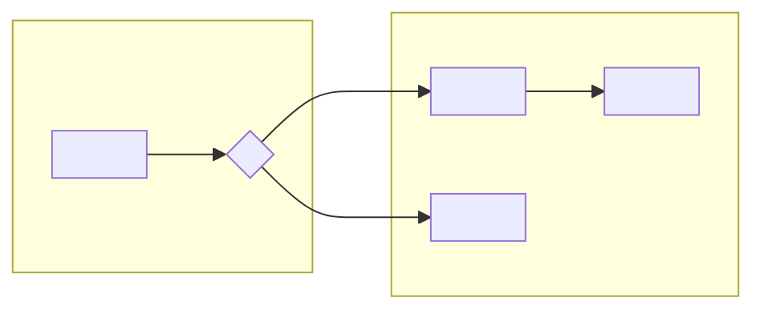

# Functional Requirements Document (FRD) Template

## How to use this template

This template sets out a standard 13-section structure for any Functional Requirements Document. Create **one FRD per PRD feature** (`F-xxx`) — generated at workflow Step 14 by the FRD agent (Fenn) from the **PO-approved PRD**. Replace every `<placeholder>`, and delete the guidance notes in *italics* before review.

- Write in plain business language: what the user does, what the system does, what the user sees.
- Every requirement in Section 4 follows the same three-part pattern: **Screen reference → Acceptance Criteria → Key Transactions**.
- Every screen in Section 5 gets one attribute table with the same six columns.
- Anything unknown is written as "To be confirmed" **and** recorded where the ready-for-dev gate can count it: a question `Q-<n>` in Section 12, or an inline `[ASSUMPTION A-<n>: <what we assume>]` where the value is used. Never left blank.
- Figma links and ADO IDs are optional. When there is none, write "Not linked". "Not linked" is not a question and does not block anything.
- Keep cross-references consistent: each Section 4 requirement should map to a Section 5 screen.
- **Stable IDs:** every requirement gets a permanent ID in the form `FR-<Feature ID>-<nn>` (e.g. `FR-F001-03`). IDs are never reused or renumbered across versions — a removed requirement is marked *Withdrawn*, and a new one takes the next free number even if it is inserted mid-section. Section numbers (4.1, 4.2 …) are for reading order only; all cross-references (stories, ADO, other FRDs) use the FR ID.
- **Traceability:** the PRD ID/version and PRD Feature ID in the header are mandatory. The FRD must not introduce scope that is not in its PRD feature — raise it as an Open Question instead.

*Guarded BMAD rules for this document (keep this note out of the final FRD):*

- *The front matter above is what the guards read. `approval_status` goes draft → review → approved, and only Warden (`agent-approval-grant`) writes `approved`. The Status row in the header table below is display text only.*
- *Question and assumption ids are never renumbered, reused or removed. Only a named person writes a `Resolved:` line or an `[ASSUMPTION-RESOLVED A-<n>: … — <name>, <YYYY-MM-DD>]` tag.*

## Product Overview (document header)

**FRD - \<Feature ID, e.g. F-001\> - \<Feature Name\>**

| Field | Value |
| --- | --- |
| FRD ID | FRD-\<project code\>-\<Feature ID\> (e.g. FRD-ABC-F001) |
| Source PRD | \<PRD ID\> — v\<x.y\> (approved \<date\>) |
| PRD Feature | \<Feature ID\>: \<Feature Name\> |
| ADO Parent Feature | \<ADO Feature work item ID, or "Not linked"\> (synced at Step 13) |
| ADO Epic | \<ADO Epic ID, or "Not linked"\> |
| Module | \<Module / product area\> |
| Document Type | Functional Requirement Document |
| Status | \<Draft / In Review / Approved / Superseded\> (display only; the front matter `approval_status` is the record) |
| Date | \<DD Mon YYYY\> |
| Version | \<1.0\> |
| Generated by | FRD agent (Fenn, `experion-frd`) |
| Drafter (BA) | \<Business Analyst name\> |
| Product Manager | \<PM name\> |
| Approver (PO) | \<Product Owner name\> |
| Supersedes | \<previous FRD version, or "—"\> |

### Version history

| Version | Date | Author | Change summary |
| --- | --- | --- | --- |
| 1.0 | \<date\> | \<name\> | Initial draft |

### Table of contents

1. Objective
2. Upstream & Downstream Processes
3. Process Flow
4. Requirement Details
5. Screens & Attributes
6. Figma Screens
7. Dependent Features
8. Non-Functional Requirements
9. Data Conversion Requirements
10. Out of Scope
11. Dependencies and Constraints
12. Open Questions
13. Appendix

## 1. Objective

*Three to five short paragraphs. Cover: what the capability lets users do and where; key business terms defined in plain words; the main rules and locks; how records stay in sync; who uses it; the business value.*

\<Capability\> lets the \<team\> handle \<business objects\> directly on the \<screen\> of a \<parent record\>. A \<term\> is \<plain definition\>.

The \<primary user\> works on \<record types\>. When \<condition\>, the system \<indicator / behaviour\> so the user \<outcome\>.

While \<state\>, the \<object\> is \<restriction\>. If anyone tries to \<blocked action\>, the system shows a message and blocks it.

Every \<action list\> keeps \<N\> records in step: \<record 1\>, \<record 2\>, \<record 3\>, and each action is recorded in \<audit / history\>.

The people who use this capability are \<roles\>. The business value is \<value 1\>, \<value 2\> and \<value 3\>.

## 2. Upstream & Downstream Processes

This section shows, in plain business terms, what comes before this capability and what it hands on afterwards.

### 2.1. How Users Arrive Here (Upstream)

| # | Comes From | What Happens | Who |
| --- | --- | --- | --- |
| 1 | \<Source process / module\> | \<What creates the input and how it reaches this feature\> | \<Roles\> |
| 2 | \<Source process / module\> | \<…\> | \<Roles\> |

### 2.2. Where It Leads (Downstream)

\<One sentence on what is handed on so nothing is re-entered elsewhere.\>

| # | Leads To | What this Capability Hands Over / Why |
| --- | --- | --- |
| 1 | \<Target module / process\> | \<Data or event handed over, and why\> |
| 2 | \<Reporting / Billing / Accounting\> | \<…\> |

## 3. Process Flow

*The end-to-end flow as a Mermaid flowchart, one subgraph (swimlane) per role or system. Show the entry points from 2.1, each decision point, and the hand-offs from 2.2. A linked image is optional, in addition to the Mermaid text.*

## 4. Requirement Details

*One numbered subsection per capability, named as a verb phrase (e.g. "Create an Order from the Customer Record"). Repeat the block below for 4.1, 4.2, 4.3 … Typical set: view, create, link/add, edit, remove, cancel, approve/reject, restrict/lock, record history, bulk actions, notifications, view details.*

### 4.\<n\>. \<FR-Fxxx-nn\> — \<Verb phrase describing the capability\>

Screen: Section 5.\<n\>. Figma: \<link, or "Not linked"\> (list one per variant, e.g. by user role or record type)

#### 4.\<n\>.1. Acceptance Criteria

1. When \<user\> \<action/trigger\>, the system \<behaviour\>.
2. For \<variant A\> the system \<behaviour\>; for \<variant B\> it \<behaviour\>.
3. \<Default values, list ordering and display format, e.g. "\<Code\> - \<Name\>, ascending by Code"\>.
4. \<Calculation rule, e.g. Balance = Total less Paid\>.
5. \<Validation and limits: min/max, decimals, character limits\>.
    1. \<Sub-rule for a specific case\>
    2. \<Sub-rule for a specific case\>
6. \<Related records updated together; audit / history entry recorded\>.
7. \<Disable / block conditions and the message shown\>.
8. \<Concurrency: optimistic-concurrency check applied\>.

#### 4.\<n\>.2. Key Transactions

| # | Trigger | What Happens | User Sees |
| --- | --- | --- | --- |
| 1 | \<User action — happy path\> | \<System behaviour and records updated\> | Toast "\<Success message\>" and \<refreshed values\> |
| 2 | \<User action — alternate path\> | \<System behaviour\> | \<Screen / message\> |
| 3 | \<User action — validation failure\> | The system blocks the action | Inline "\<Error message\>" on \<field\> |

*Writing rules for this section:*

- Use exact UI text in quotes for toasts, tooltips, modals and inline errors.
- State every formula in words (e.g. Total less Discount).
- Name the variants explicitly (user role, record type, status) rather than implying them.
- Reference the sibling FRD when behaviour is covered elsewhere (e.g. "covered as part of \<FRD ID\> / \<FR ID\>").
- A value nobody has confirmed yet: "To be confirmed" plus a `Q-<n>` in Section 12, or `[ASSUMPTION A-<n>: <the value we assume>]` right here.

## 5. Screens & Attributes

*One subsection per screen, panel, modal or grid, titled "\<Screen name\> - \<what the user does there\>". Add one or two sentences on purpose, variants and row actions, then the attribute table. A message-only modal gets a description and no table.*

### 5.\<n\>. \<Screen name\> - \<Purpose in a few words\>

\<Purpose of the screen, variants (e.g. tabs per record type), row actions, and any standard grid behaviours: search, filter, sort, export, pagination.\>

| # | Attribute | Description | Field Type | Data Type | Mandatory |
| --- | --- | --- | --- | --- | --- |
| 1 | \<Field name\> | \<Meaning, default, source, display format\> | Read only | String | Yes |
| 2 | \<Quantity field\> | \<Default; min/max; step\> | Numeric stepper | Decimal | Yes |
| 3 | \<Selection field\> | \<List source and sort order\> | Dropdown | String | Yes |
| 4 | \<Flag\> | \<When enabled; default\> | Toggle | Boolean | No |
| 5 | \<Note\> | \<Character limit, live count\> | Text box | String | No |

*Field Type values: Read only, Text box, Decimal field, Numeric stepper, Dropdown, Toggle, Tabs, Selection, Icons / menu. Data Type values: String, Integer, Decimal, Boolean, Date, Date Time.*

## 6. Figma Screens

*Optional.* \<Figma file link(s) per screen, or "Not linked". With no Figma at all, keep Section 5 complete.\>

## 7. Dependent Features

| # | PRD Feature / FRD | Direction | What the connection is for | What information passes across | What sets it off |
| --- | --- | --- | --- | --- | --- |
| 1 | \<Feature name\> (\<F-xxx\> / \<FRD ID\>) | Upstream | \<Why this feature needs it\> | \<Data elements\> | \<Triggering event\> |
| 2 | \<Feature name\> (\<F-xxx\> / \<FRD ID\>) | Lateral | \<…\> | \<…\> | \<…\> |
| 3 | \<Feature name\> (\<F-xxx\> / \<FRD ID\>) | Downstream | \<…\> | \<…\> | \<…\> |

## 8. Non-Functional Requirements

*NFRs are inherited from the PRD, not rewritten. List every PRD NFR whose "Applies to" is "All" or includes this Feature ID. Do not change the PRD target — if this feature cannot meet it, raise an Open Question.*

### 8.1. Inherited NFRs (from PRD)

| # | NFR ID | Category | PRD target | How it applies to this feature |
| --- | --- | --- | --- | --- |
| 1 | NFR-\<nnn\> | Performance | \<target as stated in PRD\> | \<e.g. applies to grid load and save actions in FR-F001-01, FR-F001-04\> |
| 2 | NFR-\<nnn\> | Security | \<target\> | \<…\> |
| 3 | NFR-\<nnn\> | Compatibility | \<target\> | \<…\> |

### 8.2. Feature-Specific NFRs

*Only requirements that are specific to this feature and not already covered by a PRD NFR. Use IDs `FNFR-<Feature ID>-<nn>`. If one of these should apply to other features too, raise it as an Open Question so it can be added to the PRD.*

| # | FNFR ID | Category | Requirement | Measurable target | Verification |
| --- | --- | --- | --- | --- | --- |
| 1 | FNFR-\<Fxxx\>-01 | Reliability | \<e.g. optimistic-concurrency check on all update actions; invalid values never saved\> | \<target\> | \<test / review\> |
| 2 | FNFR-\<Fxxx\>-02 | Integrity / business locks | \<What the system must block and the only exceptions allowed\> | \<target\> | \<…\> |
| 3 | FNFR-\<Fxxx\>-03 | Auditability | \<What is audit-logged (actor, timestamp, before/after values)\> | \<target\> | \<…\> |

### 8.3. Data Volume & Growth (Planning Assumptions - to Validate)

| # | Entity | Year 1 (Launch) | Avg. Growth / Yr | Year 2 | Year 3 |
| --- | --- | --- | --- | --- | --- |
| 1 | \<Entity per site / tenant\> | To be confirmed (Q-\<n\>) | To be confirmed | To be confirmed | To be confirmed |
| 2 | \<Entity per site / tenant\> | To be confirmed | To be confirmed | To be confirmed | To be confirmed |

## 9. Data Conversion Requirements

1. \<Legacy data to migrate, mapping rules, cut-over approach\> — or "None identified at the time of writing" with a `Q-<n>` to confirm it.

## 10. Out of Scope

1. \<Excluded capability\> - \<where it is handled instead\>.
2. \<Excluded variant or partial action\> - \<reason\>.
3. \<Upstream/downstream process owned by another module\> - handled in \<module\>.

## 11. Dependencies and Constraints

### 11.1. Dependencies

1. \<Data or record that must already exist\>.
2. \<Parent record / configuration required\>.
3. \<Other module or process that must be available\>.
4. \<Master data (e.g. users, reference lists) required for selections\>.

### 11.2. Constraints

1. \<Business lock or restriction\>.
2. \<Quantity / value limits, stated as formulas\>.
3. \<Actions disabled under specific conditions\>.
4. \<Item types or variants excluded from an action\>.
5. \<House standards, e.g. field length limits\>.

## 12. Open Questions

*The ready-for-dev gate counts this list, so it is a list, not a table. One top-level item per question, each with an id that is never renumbered, reused or removed. A person records the answer as a `Resolved:` line ending with their name and the date; the agent never writes it. A story of this feature cannot go to development while any question here is open. Write "None." when there are no questions.*

- Q-1: \<Question\> (raised by \<name\>)
- Q-2: \<Question\> (raised by \<name\>)
  Resolved: \<Answer\> — \<name\>, \<YYYY-MM-DD\>

## 13. Appendix

- HLD: \<link, or "Not linked"\>
- FE HLD: \<link, or "Not linked"\>
- Data Models: \<link, or "Not linked"\>
- Glossary: \<term\> — \<definition\>
