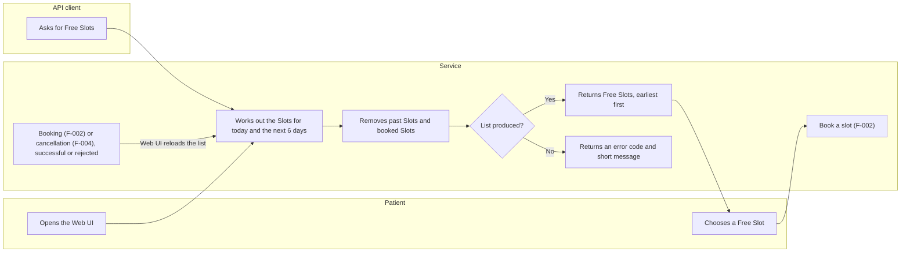

## Product Overview

**FRD - F-001 - List free slots**

| Field | Value |
| --- | --- |
| FRD ID | FRD-CLINIC-F001 |
| Source PRD | PRD: Clinic Appointment API — v1 (approved 27 Nov 2026) |
| PRD Feature | F-001: List free slots |
| ADO Parent Feature | Not linked |
| ADO Epic | Not linked |
| Module | Clinic appointment demo |
| Document Type | Functional Requirement Document |
| Status | Draft (display only; the front matter `approval_status` is the record) |
| Date | 27 Nov 2026 |
| Version | 1.1 |
| Generated by | FRD agent (Fenn, `experion-frd`) |
| Drafter (BA) | BA (Q-7) |
| Product Manager | PM (Q-7) |
| Approver (PO) | PO (Q-7) |
| Supersedes | 1.0 |

### Version history

| Version | Date | Author | Change summary |
| --- | --- | --- | --- |
| 1.0 | 27 Nov 2026 | Fenn | Initial draft |
| 1.1 | 27 Nov 2026 | Fenn | Applied answers given in chat for Q-1 to Q-6, fixed review findings R-1 to R-3, added Q-8; applied chat answers for Q-7 and Q-8 |

### Table of contents

1. Objective
2. Upstream & Downstream Processes
3. Process Flow
4. Requirement Details
5. Screens & Attributes
6. Figma Screens
7. Dependent Features
8. Non-Functional Requirements
9. Data Conversion Requirements
10. Out of Scope
11. Dependencies and Constraints
12. Open Questions
13. Appendix

## 1. Objective

This capability lets a Patient see the Free Slots for the next 7 days. The Patient sees them on the Web UI. The same list is also available through the API without the Web UI.

A Slot is a fixed 30-minute appointment time for the one doctor. A Free Slot is a Slot that is not past and has no active Booking. A Slot is past once its start time arrives. "Next 7 days" means today and the 6 days after it.

Slots run every day, every 30 minutes. The first Slot starts at 09:00 and the last starts at 16:30. The service creates Slots automatically, so the 7-day window is always filled. Past Slots and booked Slots are never shown.

The list reflects Bookings. A booked Slot leaves the list. A cancelled Booking returns its Slot to the list, if the Slot is not past. All times use the local time zone of the machine that runs the service.

The users are the Patient and the internal pilot team. The value is that a Patient can find a free time quickly, and the team can see the booking flow working. This is a demo with fake data only.

## 2. Upstream & Downstream Processes

This section shows what comes before this capability and what it hands on afterwards.

### 2.1. How Users Arrive Here (Upstream)

| # | Comes From | What Happens | Who |
| --- | --- | --- | --- |
| 1 | Web UI (F-005) | The Patient opens the single page and sees the Free Slots | Patient |
| 2 | API client | A client asks for the Free Slots without the Web UI | Internal pilot team, or a later mobile app (out of scope for v1) |
| 3 | Book a slot (F-002) or Cancel a booking (F-004) | After a successful or rejected action, the Web UI reloads the Free Slots list | Patient |

### 2.2. Where It Leads (Downstream)

The chosen Slot's date and start time are handed on, so the Patient does not type them again.

| # | Leads To | What this Capability Hands Over / Why |
| --- | --- | --- |
| 1 | Book a slot (F-002) | The date and start time of the chosen Free Slot, so it can be booked |

## 3. Process Flow

## 4. Requirement Details

### 4.1. FR-F001-01 — View Free Slots on the Web UI

Screen: Section 5.1. Figma: Not linked

#### 4.1.1. Acceptance Criteria

1. When the Patient opens the Web UI, the system shows the Free Slots without asking for an OP ID first. [ASSUMPTION A-1: The list loads when the page opens, with no OP ID entered, and does not refresh by itself as time passes. It also loads again when the page is opened again.]
2. The system shows only Slots for today and the 6 days after it.
3. Slots run every 30 minutes, every day. The first starts at 09:00 and the last starts at 16:30, which gives 16 Slots a day and at most 112 Slots in the list.
4. The service creates the Slots automatically. No person sets them up, and the 7-day window is always filled.
5. A Slot whose start time is now or earlier is past and is not shown.
6. A Slot that has an active Booking is not shown.
7. When a Booking for a Slot is cancelled and the Slot is not past, the Slot is shown again.
8. Each Slot shows its date and start time in the local time zone of the machine that runs the service. [ASSUMPTION A-2: The date shows as "Fri, 27 Nov 2026" and the start time shows on the 24-hour clock as "09:00".]
9. Slots are ordered by date and start time, earliest first. [ASSUMPTION A-3: Slots are grouped under their date, and a date with no Free Slot is not shown.]
10. After a successful booking or cancellation, the list reloads without a manual page reload.
11. When there is no Free Slot to show, the Web UI shows "No free slots in the next 7 days." (Q-1).
12. When the list cannot be loaded, the system shows a short message that names the reason. If the service sends a message, that message is shown. The message for `INTERNAL_ERROR` is "Something went wrong.". If no readable response arrives, the Web UI shows "Cannot reach the service." (Q-3).
13. After a rejected booking or cancellation, the list reloads without a manual page reload (Q-2).

#### 4.1.2. Key Transactions

| # | Trigger | What Happens | User Sees |
| --- | --- | --- | --- |
| 1 | Patient opens the Web UI and Free Slots exist | The system works out the Free Slots for the next 7 days | The Free Slots, earliest first |
| 2 | Patient opens the Web UI and no Free Slot exists | The system returns an empty list | "No free slots in the next 7 days." (Q-1) |
| 3 | A booking or cancellation succeeds or is rejected (F-002, F-004) | The list is loaded again | The updated Free Slots |
| 4 | The list cannot be loaded | No list is returned | The service message, "Something went wrong." for `INTERNAL_ERROR`, or "Cannot reach the service." when no readable response arrives (Q-3) |
| 5 | Validation failure | Not applicable: viewing the list takes no user input | Nothing |

### 4.2. FR-F001-02 — List Free Slots through the API

Screen: none. This requirement is used without the Web UI. Figma: Not linked

#### 4.2.1. Acceptance Criteria

1. When a client sends `GET /api/slots`, the system returns the Free Slots. No OP ID is needed.
2. The Free Slot rules are the same as in FR-F001-01, criteria 2 to 7.
3. A successful response has status 200 and the form `{"slots":[{"slot_start"}]}`. Each `slot_start` is a local date and time written as `YYYY-MM-DDTHH:MM`, with no time zone offset.
4. Slots are ordered by `slot_start`, earliest first.
5. When there is no Free Slot, the response has status 200 and an empty `slots` list.
6. Unknown query parameters are ignored. This is accepted under NFR-006 (Q-4).
7. Every error has the form `{"error":{"code","message"}}`, with one short fixed message for each code and no internal details. The cases are:
    1. A Host header other than `127.0.0.1` or `localhost`: `INVALID_HOST`, status 400. Message: "This address is not allowed." (Q-8).
    2. A wrong method on this path: `METHOD_NOT_ALLOWED`, status 405. Message: "This action is not allowed." (Q-8).
    3. Anything unexpected, including storage staying busy for more than 5 seconds: `INTERNAL_ERROR`, status 500. Message: "Something went wrong." (Q-3).

#### 4.2.2. Key Transactions

| # | Trigger | What Happens | User Sees |
| --- | --- | --- | --- |
| 1 | Client asks for Free Slots | The system works out the Free Slots | Status 200 with the list |
| 2 | Client asks when no Free Slot exists | The system returns an empty list | Status 200 with an empty `slots` list |
| 3 | Request fails the Host check or uses a wrong method | The system rejects the request | The matching error code and message |
| 4 | An unexpected failure happens | The system returns no list | `INTERNAL_ERROR`, "Something went wrong." (Q-3) |

## 5. Screens & Attributes

### 5.1. Booking page - See Free Slots

The Free Slots part of the single-page Web UI (F-005). It is the same for every Patient. It lists Free Slots earliest first. It has no search, filter, user sorting, export or pagination. [ASSUMPTION A-4: The list has no search, filter, user sorting, export or pagination, and shows no special loading indicator.] The action to book a Slot is covered by F-002.

| # | Attribute | Description | Field Type | Data Type | Mandatory |
| --- | --- | --- | --- | --- | --- |
| 1 | List heading | Names the list. [ASSUMPTION A-5: The heading text is "Free slots".] | Read only | String | Yes |
| 2 | Slot date | Local date of the Slot, from today to today plus 6 days. Display format as in A-2 | Read only | Date | Yes |
| 3 | Slot start time | Local start time, 09:00 to 16:30 in 30-minute steps. Display format as in A-2 | Read only | Date Time | Yes |
| 4 | Empty state | Shown when there is no Free Slot. Text: "No free slots in the next 7 days." (Q-1) | Read only | String | No |
| 5 | Load error message | Shown when the list cannot be loaded. The service message, or "Cannot reach the service." when no readable response arrives (Q-3) | Read only | String | No |

## 6. Figma Screens

Not linked

## 7. Dependent Features

| # | PRD Feature / FRD | Direction | What the connection is for | What information passes across | What sets it off |
| --- | --- | --- | --- | --- | --- |
| 1 | Book a slot (F-002) | Downstream | The Patient books a Slot chosen from this list | Slot date and start time | Patient chooses to book a Slot |
| 2 | Book a slot (F-002) | Upstream | A booked Slot must leave this list | The Slot's active Booking | A successful booking |
| 3 | Cancel a booking (F-004) | Upstream | A freed Slot must return to this list | The cancelled Booking's Slot | A successful cancellation |
| 4 | Single-page web UI (F-005) | Lateral | The list is shown on the single page | Free Slots | Page open, successful or rejected booking or cancellation |

## 8. Non-Functional Requirements

### 8.1. Inherited NFRs (from PRD)

| # | NFR ID | Category | PRD target | How it applies to this feature |
| --- | --- | --- | --- | --- |
| 1 | NFR-001 | Local only | The service accepts connections from the same machine only. | The Free Slots list in FR-F001-01 and FR-F001-02 is reachable from the same machine only |
| 2 | NFR-002 | Fake data only | Seed data and tests contain no real personal or health data. | Test data for FR-F001-01 and FR-F001-02 is fake |
| 3 | NFR-004 | Data is kept | Bookings remain after a service restart. A restart does not duplicate Slots or seed data. | After a restart, booked Slots stay hidden and no Slot appears twice in FR-F001-01 and FR-F001-02 |
| 4 | NFR-005 | OP ID protection | OP IDs do not appear in URLs or logs. | Listing Free Slots takes no OP ID. No OP ID appears in the URL or logs for FR-F001-01 and FR-F001-02 |
| 5 | NFR-006 | Input checks | The service validates every input and rejects invalid values without showing internal errors. | Errors in FR-F001-02 show no internal details. Unknown query parameters are ignored (Q-4) |

### 8.2. Feature-Specific NFRs

None.

### 8.3. Data Volume & Growth (Planning Assumptions - to Validate)

| # | Entity | Year 1 (Launch) | Avg. Growth / Yr | Year 2 | Year 3 |
| --- | --- | --- | --- | --- | --- |
| 1 | Slots in the 7-day window (calculated, not stored) | At most 112 | None | At most 112 | At most 112 |
| 2 | Bookings checked to find Free Slots | Demo scale (Q-5) | No growth planned | Demo scale | Demo scale |

## 9. Data Conversion Requirements

1. None. No existing data is moved into this feature (Q-6).

## 10. Out of Scope

1. Booking a Slot - handled in F-002.
2. Listing a Patient's own Bookings - handled in F-003.
3. Cancelling a Booking - handled in F-004.
4. The rest of the single page, including OP ID entry - handled in F-005.
5. Mobile app and login - later.
6. Staff or admin screens, including managing Slots - not in this version.
7. More than one clinic or doctor - not in this version.
8. Access from other machines or the internet - local only for now.

## 11. Dependencies and Constraints

### 11.1. Dependencies

1. The service is running on the local machine.
2. Booking records, which decide whether a Slot is free (F-002, F-004).
3. The clock and time zone of the machine that runs the service. For testing, the architecture allows the starting time to be set with `CLINIC_NOW`.

### 11.2. Constraints

1. One doctor and one clinic.
2. A Slot lasts 30 minutes. Start times run from 09:00 to 16:30, every day.
3. The list covers today plus the 6 days after it.
4. A Slot is free only when its start time is later than now and it has no active Booking.
5. The Web UI makes no time decisions. The service decides which Slots are free.
6. Changes to daylight saving time or time zones are not handled in this demo.

## 12. Open Questions

- Q-1: What does the Web UI show when there is no Free Slot (exact text)? PRD open question 3 and the architecture leave this to UX design or this FRD. (raised by Fenn)
- Q-2: After a rejected booking or cancellation, does the Free Slots list reload? PRD open question 3 and the architecture leave this open. (raised by Fenn)
- Q-3: What exact text is shown when the list cannot be loaded: the `INTERNAL_ERROR` message, and the Web UI's own text when no readable response arrives? (raised by Fenn)
- Q-4: Architecture AD-6 says unknown query parameters are ignored. PRD NFR-006 says the service validates every input and rejects invalid values. Is ignoring unknown query parameters accepted under NFR-006? (raised by Fenn)
- Q-5: What Booking volume and yearly growth should be planned for? No source gives it. (raised by Fenn)
- Q-6: Please confirm that no existing data needs to be moved into this feature. (raised by Fenn)
- Q-7: Who are the Business Analyst, Product Manager and Product Owner (approver) for this FRD? (raised by Fenn)
- Q-8: What exact message text goes with the `INVALID_HOST` and `METHOD_NOT_ALLOWED` errors? (raised by Fenn)

## 13. Appendix

- HLD: `_bmad-output/planning-artifacts/architecture/architecture-clinic-demo-2026-11-27/ARCHITECTURE-SPINE.md` (v1)
- FE HLD: Not linked
- Data Models: Architecture spine, AD-10 (same file as HLD)
- Glossary:
    - Patient — a person in the seed data, identified by one OP ID. A Patient can have many Bookings.
    - OP ID — outpatient ID. A fake ID from seed data.
    - Slot — a fixed 30-minute appointment time for the one doctor. A Slot is past once its start time arrives. Times use the time zone of the machine that runs the service.
    - Free Slot — a Slot that is not past and has no active Booking.
    - Booking — one Patient's hold on one Slot. It is active until cancelled. A Slot has at most one active Booking.
    - Web UI — the single web page used by the Patient.
